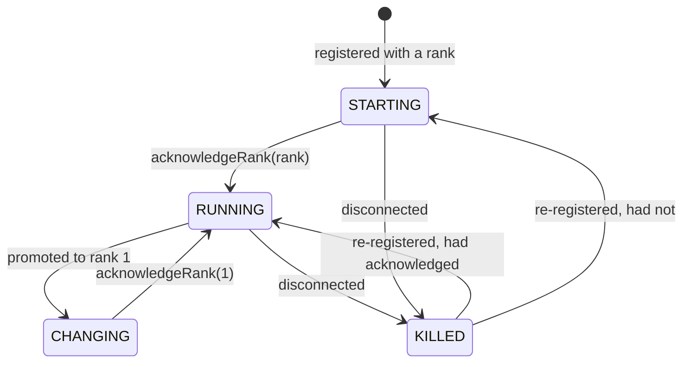

# Archon SDK developer guide

This guide shows how to write a Java application that runs on Archon with the `archon-sdk` library: how it
registers, takes a rank and plays its role, serves and consumes services, reads and changes configurations, joins
with TLS, and has its logs watched live from the portal.

For how Archon itself works, see the [technical reference](technical-reference.md). The `Group:Application` example
in the `lunar-perihelion` repository is a complete application built the way this guide describes.

## Contents

1. [What the SDK does for you](#1-what-the-sdk-does-for-you)
2. [Setting up a project](#2-setting-up-a-project)
3. [Before the first run](#3-before-the-first-run)
4. [A first application](#4-a-first-application)
5. [Lifecycle and threads](#5-lifecycle-and-threads)
6. [Leaders and mirrors](#6-leaders-and-mirrors)
7. [Serving a service](#7-serving-a-service)
8. [Using a service](#8-using-a-service)
9. [Messages](#9-messages)
10. [Configurations](#10-configurations)
11. [TLS](#11-tls)
12. [Logging and live logs](#12-logging-and-live-logs)
13. [Running and deploying](#13-running-and-deploying)
14. [API summary](#14-api-summary)
15. [Troubleshooting](#15-troubleshooting)

---

## 1. What the SDK does for you

Once your application calls `ArchonInterface.initialize`, the SDK:

* finds the primary registry among the registry addresses, however long it takes to come up;
* with TLS on, gets the instance a certificate with its join token, and renews it before it expires;
* registers the instance and hands you its **rank**: 1 for the application's leader, higher for mirrors;
* tells you every time the rank changes, as when the leader dies and this instance is promoted;
* reconnects to whichever registry becomes primary after a failover, keeping the instance's rank and services;
* serves your services on the right port and tells the registry, so clients can find them;
* connects your clients to services and follows them across failovers;
* keeps every configuration your application sees in memory, and tells you when one changes;
* captures your log lines so operators can watch them live in the portal.

Your application decides what each role does, and tells the SDK when it is ready for its rank.

## 2. Setting up a project

The SDK needs **Java 17** or later.

Build and install DataBridge and Archon to your local Maven repository, then depend on the SDK:

```xml
<dependency>
    <groupId>dev.heysulo.archon.sdk</groupId>
    <artifactId>archon-sdk</artifactId>
    <version>1.0-SNAPSHOT</version>
</dependency>
```

The SDK logs through **slf4j** but does not choose a logging library for you. Add one, or the SDK's own messages, and
yours, go nowhere:

```xml
<!-- The simplest: lines to standard error -->
<dependency>
    <groupId>org.slf4j</groupId>
    <artifactId>slf4j-simple</artifactId>
    <version>1.7.36</version>
</dependency>
```

Logback, Log4j 2 (through its slf4j binding) and java.util.logging (through `slf4j-jdk14`) work too, and give the
portal richer log lines ([§12](#12-logging-and-live-logs)).

Package the application with its dependencies, for example with the Maven Shade plugin, to run it as one jar.

## 3. Before the first run

An instance can only register if its application is known to Archon. In the portal:

1. **Applications → Define application.** Enter the group and name your code will register with, such as `Shop` and
   `Cart`. Undefined applications are refused with *Application is not defined*.
2. **Services → Add service**, for each service your application serves: its id (such as `cart`), the owner
   (`Shop:Cart`), a port offset no other service uses, and the mode ([§7](#7-serving-a-service)).
3. **Configurations**, for any values your application reads ([§10](#10-configurations)).
4. With TLS on, **Applications → Join tokens** for your application, and note the CA fingerprint
   ([§11](#11-tls)).

Then give each instance its environment:

| Variable | Needed | Meaning |
|---|---|---|
| `ARCHON_REGISTRY_LOCATIONS` | always | Every registry's address, separated by `\|`, such as `10.21.3.201\|10.21.3.202\|10.21.3.203`. |
| `ARCHON_BASE_PORT` | to serve | Services listen on this plus their port offset. |
| `ARCHON_ADVERTISED_HOST` | behind NAT | The address clients should use to reach this instance, such as a Kubernetes pod IP. Defaults to this machine's address. |
| `ARCHON_NODE_NAME` | no | Shown in the portal, such as the machine or Kubernetes node. |
| `ARCHON_TLS` | with TLS | `optional` or `required`. Default `off`. |
| `ARCHON_CA_FINGERPRINT` | with TLS | The Archon CA's SHA-256 fingerprint. |
| `ARCHON_JOIN_TOKEN` | with TLS | A join token for this application. |
| `ARCHON_LOG_CAPTURE` | no | `off` to keep logs from the portal. |

## 4. A first application

```java
import dev.heysulo.archon.dictionary.sdk.RegistryProtocol;
import dev.heysulo.archon.sdk.ArchonCallback;
import dev.heysulo.archon.sdk.ArchonInterface;

public final class CartApplication implements ArchonCallback {
    private final ArchonInterface archon = ArchonInterface.getInstance();

    public static void main(String[] args) {
        new CartApplication().start();
    }

    private void start() {
        // Blocks until a primary registry answers and this instance has a rank
        int rank = archon.initialize("Shop", "Cart", this);
        System.out.println("Registered with rank " + rank);
        // main may return: the registry connection's threads keep the process running
    }

    // Runs on the SDK's callback thread: first with the rank initialize returned, then on every change
    @Override
    public void onRankUpdateMessage(int rank) {
        if (rank == RegistryProtocol.RANK_PRIMARY) {
            // become the leader...
        } else {
            // become a mirror...
        }
        // Ready for this rank: until now the registry kept the instance as starting
        archon.acknowledgeRank(rank);
    }
}
```

Start three of these and the portal shows `Shop:Cart` with ranks 1, 2 and 3. Stop the leader and the next ready
instance is promoted to rank 1, and its `onRankUpdateMessage(1)` runs.

## 5. Lifecycle and threads

### 5.1 `initialize`

`initialize(group, name, callback)` is called **once per process**. It:

1. starts capturing logs;
2. with TLS on, joins: gets a certificate, trying each registry until one issues it;
3. waits, however long it takes, for a primary registry to answer, since registries and applications may start in
   any order;
4. registers, and waits up to 5 seconds for the rank;
5. connects to archon-config and waits up to 5 seconds for the configurations; if they are late, it returns without
   them and they arrive in the background.

It returns the rank, which `onRankUpdateMessage` also receives. It throws `PrimaryRegistryCommunicationFailure` if
interrupted or if no rank arrives in time.

### 5.2 Instance states



Only `RUNNING` instances can be promoted. An instance that never acknowledges stays `STARTING`, and if every other
instance is starting too, the application has no leader to fail over to.

### 5.3 Threads

| Thread | Runs | Rule |
|---|---|---|
| The SDK callback thread | `ArchonCallback`: rank changes, termination, configuration changes | One call at a time, in the order things happened. May call blocking SDK methods. A slow callback delays the next, so hand long work to your own thread. |
| Network threads | `ServiceClientCallback`, your services' `ServerCallback` | Never block: a slow call holds up every message after it, and a blocking SDK call may wait for an answer that very thread must deliver. On the registry connection's own thread the SDK refuses blocking calls with `IllegalStateException`. |
| Your threads | Everything else | Any SDK method may be called from any thread. |

### 5.4 Reconnecting

When the registry connection drops, as when the primary registry fails over, the SDK finds the new primary and
re-registers in the background with the same rank, telling it whether the rank was acknowledged, then announces
the instance's services again. Your application does not see this, apart from blocking calls such as service lookups
waiting until it is done. Configuration and service connections reconnect the same way.

### 5.5 Termination

The registry can tell an instance to stop: its application is not defined, another instance holds its rank, or its
certificate does not match. The SDK then stops talking to the registry and calls `onTerminated(reason)`. By default
that **exits the process**, so its orchestrator starts a fresh instance, which registers with a new rank. Override it
to shut down gracefully, but stop acting on the old rank:

```java
@Override
public void onTerminated(String reason) {
    log.error("Stopped by the registry: {}", reason);
    shutDownGracefully();
    System.exit(1);
}
```

`archon.isTerminated()` tells you afterwards.

## 6. Leaders and mirrors

Most applications have work only one instance should do at a time: serve a primary/mirror service, own a schedule,
write to a single resource. Rank 1 does it; the others stand by, ready to take over.

The pattern the example application uses:

* **One role thread.** Rank changes, and anything that depends on the role, run on a single thread of your own, so
  they never race.
* **Idempotent `applyRole`.** It reads the current rank and brings the instance into that role from wherever it is:
  starts or stops services, connects or disconnects clients. Running it twice does no harm.
* **Acknowledge when ready.** Only after the role's work succeeded. If it failed, retry later, and do not
  acknowledge yet.
* **Acknowledge the newest rank.** The rank may change again before you acknowledge. Acknowledging an old rank is
  ignored; `acknowledgeRank` returns `false`.

```java
private final ScheduledExecutorService roles = Executors.newSingleThreadScheduledExecutor();
private volatile int rank;

@Override
public void onRankUpdateMessage(int newRank) {
    rank = newRank;
    roles.execute(this::applyRole);
}

// On the role thread
private void applyRole() {
    int target = rank;
    try {
        boolean ready = target == RegistryProtocol.RANK_PRIMARY ? becomeLeader() : becomeMirror();
        if (ready) {
            archon.acknowledgeRank(target);
        }
    } catch (RuntimeException e) {
        log.error("Role change failed; retrying", e);
        roles.schedule(this::applyRole, 1, TimeUnit.SECONDS);
    }
}
```

**A mirror that waits on the leader** (to connect to its service, say) should not wait forever: if the leader is
gone, only acknowledged instances can replace it. The example's mirrors acknowledge anyway after 15 seconds of
failing to reach the leader's service.

**Do not stop a leader's services in a shutdown hook.** When a leader process exits, its service and registry
connections drop together and the registry promotes a mirror at once. Closing the server first leaves clients
without a leader for as long as the close takes.

## 7. Serving a service

```java
Server server = archon.createService("cart", new CartServer());
```

`createService(id, callback)`:

1. looks the service up, and checks your application owns it;
2. starts a DataBridge server on `ARCHON_BASE_PORT` plus the service's port offset;
3. tells the registry it is running, at `ARCHON_ADVERTISED_HOST` and that port, and whether it serves TLS;
4. returns once the server listens and the registry has accepted it.

It throws `ServiceException` if the service is unknown, owned by another application, already running in this
process, its port is in use or `ARCHON_BASE_PORT` is not set, or the registry refuses it. Any rank of the owner may
serve; for a primary/mirror service, usually only the leader does.

The callback is a DataBridge `ServerCallback`:

```java
public final class CartServer implements ServerCallback {
    @Override
    public void onConnect(Server server, Connection connection) { }

    @Override
    public void onDisconnect(Server server, Connection connection) { }

    @Override
    public void onMessage(Server server, Connection connection, Message message) {
        if (message instanceof AddItem add) {
            connection.send(cart.add(add));   // reply on the same connection
        }
    }

    @Override
    public void onError(Server server, Connection connection, Throwable cause) { }
}
```

It runs on network threads ([§5.3](#53-threads)). To adjust the server before it listens, such as trusting your
message packages or changing the heartbeat:

```java
archon.createService("cart", new CartServer(), server -> {
    server.settings().addTrustedPackage("com.shop.cart.**");
    server.settings().setHeartbeatInterval(Duration.ofSeconds(3));
});
```

`archon.stopService("cart")` tells the registry first, so clients stop being sent here, then closes the server. It
does nothing if the service is not running, so a mirror can call it whenever it takes its role.

**Modes.** The service's mode, set in the portal, decides where clients go:

| Mode | Clients connect to |
|---|---|
| `PRIMARY_MIRROR` | The lowest-ranked running instance serving it, normally the leader. |
| `LOAD_BALANCE` | A random running instance serving it. Run it on every instance. |

## 8. Using a service

```java
ServiceClient cart = archon.connectToService("cart", new ServiceClientCallback() {
    @Override
    public void onMessage(ServiceClient client, Message message) {
        // a reply from the service; on a network thread, so never block here
    }

    @Override
    public void onConnect(ServiceClient client, ServiceEndpoint endpoint) {
        // connected, first or again after a failover; messages can be sent
    }

    @Override
    public void onDisconnect(ServiceClient client, ServiceEndpoint endpoint) {
        // dropped; the client is already looking the service up again
    }
});

cart.send(new AddItem("sku-42", 1));
```

`connectToService` looks the service up and connects, blocking until connected. If the connection drops later, as
when the serving instance fails over, the client looks the service up again and reconnects in the background,
calling `onDisconnect` and then `onConnect` with the new endpoint. While it is reconnecting, `send` throws
`ServiceException`. If the **first** connection fails (the service is unknown, has no running instance, or cannot be
reached), `connectToService` throws `ServiceException` and does not retry; call it again later. Close the client when
done.

**Options:**

```java
ServiceClient cart = archon.connectToService("cart", callback, ServiceClientOptions.defaults()
        .withWarmup(5_000)                                              // round trips before handing it over
        .withSettings(settings -> settings.addTrustedPackage("com.shop.cart.**")));
```

* **Warm-up.** A client that sends rarely pays for code the JVM has not compiled yet, on both ends: about 1.7 ms a
  round trip cold against 0.4 ms warm in the example. With a warm-up, the SDK sends that many round trips on every
  new connection, which the service's SDK answers without involving your code, before calling `onConnect`.
* **Settings** adjust each connection: trusted packages, heartbeat, connect timeout.

`archon.lookupService("cart")` returns the definition and the running endpoints, without connecting, for when you
want to choose yourself.

## 9. Messages

Services and their clients exchange your own message classes. A message:

* implements `dev.heysulo.databridge.core.common.Message` (which is `Serializable`);
* declares a `serialVersionUID`, and keeps it when fields change compatibly;
* has the same class on both sides, so share it in a small library both depend on;
* holds only types the other side trusts.

Every DataBridge connection deserializes through an allow-list. `dev.heysulo.**`, `java.lang.*` and the common
`java.util` collections are allowed by default; anything else, `java.time` included, must be added. **Add your own packages on both sides**: with
`server.settings().addTrustedPackage(...)` when serving, and `ServiceClientOptions.withSettings(...)` when connecting.
A message from an untrusted package is refused before it is constructed, and the receiving side reports an error on
the connection.

```java
public record AddItem(String sku, int quantity) implements Message {
    @Serial
    private static final long serialVersionUID = 1L;
}
```

Frames are limited to 16 MB. Keep messages small, and stream large data in pieces.

## 10. Configurations

Every configuration your application sees is in memory, kept current by archon-config. Reading never blocks.

```java
long interval = archon.getConfigLong("ping.intervalMillis", 1_000);
String region = archon.getConfigString("cart.region", "eu");
boolean beta  = archon.getConfigBoolean("cart.beta", false);

Optional<ConfigValue> raw = archon.getConfig("cart.region");   // with its type, level and read-only flag
Map<String, ConfigValue> all = archon.getConfigs();
```

The typed getters return the fallback when the name is not visible; the number getters also when the value is not a
number that fits. `getConfigBoolean` is true only for `true`, ignoring case.

**Which value you see.** For each name, your application's own configuration if there is one, else your group's,
else the global one. So a global default can be overridden for one group or one application, from the portal, and
your code reads the same name either way.

**Changes** arrive at once through the callback, also on startup for the first values (each as added) and after a
reconnect for anything that changed meanwhile:

```java
@Override
public void onConfigUpdated(String name, ConfigValue oldValue, ConfigValue newValue) {
    // newValue is null if the name is no longer visible; oldValue is null if it is new
    if ("ping.intervalMillis".equals(name)) {
        roles.execute(this::reschedulePings);
    }
}
```

Only changes to what this instance sees are reported: changing a global value your application overrides is not.
`getConfig` already returns the new value when the callback runs.

**Changing a value** from the application:

```java
archon.setConfig("cart.lastRebalance", Instant.now().toString());
```

It changes the configuration this instance sees, which may be shared with the group or everyone, blocks up to 5
seconds until archon-config answers, and the change then reaches every instance that sees it. It throws
`ConfigurationException` if no such configuration is visible, it is read only, the value does not fit its type, or
archon-config cannot be reached (`isUnavailable()`). Applications cannot create configurations; define them in the
portal.

**Types:** `STRING`, `INTEGER`, `DECIMAL`, `BOOLEAN`.

## 11. TLS

When the cluster runs TLS, every instance needs a certificate naming its application. The SDK gets and renews it; you
only provide two values:

```bash
ARCHON_TLS=optional            # or required, as the cluster
ARCHON_CA_FINGERPRINT=a3e075…  # from the portal: Applications → Join tokens
ARCHON_JOIN_TOKEN=ajt_…        # a join token for this application
```

* On start, the SDK generates a key pair in memory, connects to a registry trusting only the CA with that
  fingerprint, and exchanges the token for a certificate. The private key never leaves the process, and nothing is
  written to disk.
* The certificate lasts 24 hours by default. The SDK renews it two thirds of the way through with a new key, over a
  connection secured with the current one, so the token is needed only once per process.
* Registry and service connections then use TLS, and check the other side's identity: the registry must be
  `Archon:Registry`, and a service must be served by its owner. Your services serve TLS too, so nothing in your code
  changes.

**Join tokens.** Create them in the portal for your application. A **single-use** token lets one process join; a
**reusable** one suits instances that scale out, until it expires or you revoke it. Revoking stops new processes
joining with it; running ones keep their certificates. Treat tokens like passwords.

**Configuring in code**, instead of the environment, before `initialize`:

```java
ArchonTls.configure(TlsMode.REQUIRED, CaTrust.pinned(fingerprint), joinToken);
```

## 12. Logging and live logs

The portal can show any instance's log lines live. The SDK captures them from the moment `initialize` starts:

| Your logging library | How lines are captured |
|---|---|
| Logback | An appender on the root logger. Level, logger, thread and time come through exactly. |
| Log4j 2 (with `log4j-slf4j-impl`) | An appender on the root logger, likewise. A reconfiguration of Log4j removes it. |
| java.util.logging (with `slf4j-jdk14`) | A handler on the root logger, likewise. |
| slf4j-simple, or anything else writing to the console | Standard output and error are captured as written, and still reach the console. slf4j-simple's lines are read for their level, thread and logger; a stack trace keeps the level of the line that logged it. |

Nothing you do changes where your logs go; the capture only keeps a copy in memory. It never blocks your logging.

**What is kept.** Each instance keeps its latest lines at or above a level, for the moment someone opens its logs:
by default 1000 lines at WARN or above. Two configurations set this, for everyone or overridden for your group or
application: `archon.logs.memoryLines` and `archon.logs.memoryLevel`. While someone watches, every line streams,
whatever its level.

**Turning it off.** `ARCHON_LOG_CAPTURE=off`, for an application whose logs must never leave the process.

Logs often contain secrets. Watching them needs the separate `logs:view` permission in the portal.

## 13. Running and deploying

### 13.1 A container

```dockerfile
FROM eclipse-temurin:17-jre
COPY target/cart.jar /app/cart.jar
ENTRYPOINT ["java", "-jar", "/app/cart.jar"]
```

### 13.2 Kubernetes

```yaml
apiVersion: apps/v1
kind: Deployment
metadata:
  name: cart
spec:
  replicas: 3
  selector:
    matchLabels: { app: cart }
  template:
    metadata:
      labels: { app: cart }
    spec:
      containers:
        - name: cart
          image: registry.example.com/cart:1.0
          env:
            - name: ARCHON_REGISTRY_LOCATIONS
              value: "10.21.3.201|10.21.3.202|10.21.3.203"
            - name: ARCHON_BASE_PORT
              value: "9000"
            # The registry sees pods through the load balancer's NAT, so each pod says where to reach it
            - name: ARCHON_ADVERTISED_HOST
              valueFrom: { fieldRef: { fieldPath: status.podIP } }
            - name: ARCHON_NODE_NAME
              valueFrom: { fieldRef: { fieldPath: spec.nodeName } }
            - name: ARCHON_TLS
              valueFrom: { configMapKeyRef: { name: archon-tls, key: mode } }
            - name: ARCHON_CA_FINGERPRINT
              valueFrom: { configMapKeyRef: { name: archon-tls, key: ca-fingerprint } }
            - name: ARCHON_JOIN_TOKEN
              valueFrom: { secretKeyRef: { name: cart-join, key: token, optional: true } }
          ports:
            - containerPort: 9005    # 9000 + the cart service's offset
```

Use a **reusable** join token for a Deployment, in a Secret (`kubectl create secret generic cart-join
--from-literal=token=ajt_…`).

### 13.3 Anywhere else

Nothing in the SDK depends on Kubernetes. A process on a VM or a laptop registers the same way, given the
environment in [§3](#3-before-the-first-run), as long as it can reach the registry addresses and the instances it
talks to can reach its `ARCHON_ADVERTISED_HOST`.

### 13.4 Shutting down

Exit the process. The registry notices within a few seconds, marks the instance gone, and promotes another if it was
the leader. There is nothing to deregister.

## 14. API summary

### `ArchonInterface`

| Method | Does |
|---|---|
| `getInstance()` | The process's single instance. |
| `initialize(group, name, callback)` | Joins, registers and returns the rank ([§5.1](#51-initialize)). Once per process. |
| `acknowledgeRank(rank)` | Ready for this rank. Returns `false` if the rank is no longer current or the registry is unreachable for now (it is then reported on reconnect). |
| `isRankAcknowledged()` | Whether the current rank was acknowledged. |
| `isTerminated()` | Whether the registry stopped this instance. |
| `createService(id, callback[, configure])` | Serves a service ([§7](#7-serving-a-service)). |
| `stopService(id)` | Stops serving it. |
| `connectToService(id, callback[, configure \| options])` | Connects to a service ([§8](#8-using-a-service)). |
| `lookupService(id)` | A service's definition and running endpoints. |
| `getConfig(name)`, `getConfigs()` | Configurations this instance sees. |
| `getConfigString/Long/Int/Double/Boolean(name, fallback)` | Typed reads. |
| `setConfig(name, value)` | Changes a configuration this instance sees. |

### `ArchonCallback`

| Method | When |
|---|---|
| `onRankUpdateMessage(rank)` | The rank was assigned or changed. Required. |
| `onTerminated(reason)` | The registry stopped the instance. Default: exit the process. |
| `onConfigUpdated(name, oldValue, newValue)` | A configuration it sees changed. Default: nothing. |

### `ServiceClient` and `ServiceClientCallback`

| Member | Does |
|---|---|
| `send(message)` | Sends to the connected instance; throws while reconnecting. |
| `getEndpoint()`, `isConnected()`, `getServiceId()` | Where it is connected. |
| `close()` | Disconnects for good. |
| `onMessage`, `onConnect`, `onDisconnect`, `onError` | What happens on the connection, on a network thread. |

### Exceptions

| Exception | Thrown when |
|---|---|
| `PrimaryRegistryCommunicationFailure` | `initialize` is interrupted, or no rank arrives in time. |
| `ServiceException` | A service is unknown, not yours, cannot start or cannot be reached; sending while disconnected. |
| `ConfigurationException` | A configuration cannot be changed, or archon-config cannot be reached. |
| `IllegalStateException` | A blocking call on the registry connection's thread, or using the SDK before `initialize`. |

## 15. Troubleshooting

| Symptom | Cause |
|---|---|
| `initialize` never returns | No primary registry answers: check `ARCHON_REGISTRY_LOCATIONS` and that the registries can reach a majority of each other. |
| Terminated: *Application is not defined* | Define `Group:Application` in the portal, exactly as your code spells it. |
| Terminated: *Rank is held by another running instance* | Another process holds this rank, as after a long network partition. The process exits and a fresh one takes a new rank. |
| Terminated: *A certificate is required* | The cluster requires TLS; set `ARCHON_TLS`, `ARCHON_CA_FINGERPRINT` and `ARCHON_JOIN_TOKEN`. |
| *refused a certificate … The join token is not valid* | The token is for another application, revoked, or mistyped. |
| *The join token has been used* | A single-use token was spent by an earlier process; use a reusable one for scaled instances. |
| *The peer's certificate is not from the Archon CA with fingerprint …* | The fingerprint is wrong, or the address is not an Archon registry. |
| `createService` fails: *belongs to …* | The service's owner in the portal is another application. |
| `createService` fails: *ARCHON_BASE_PORT is not set* | Set it. |
| Clients cannot connect to your service | `ARCHON_ADVERTISED_HOST` is an address they cannot reach, or the port is not open. |
| A message never arrives; an error reports a rejected class | Its package is not trusted on the receiving side ([§9](#9-messages)). |
| The application has no leader | Every instance is still starting: acknowledge ranks once ready, and do not wait forever on the leader. |
| No logs in the portal | No slf4j binding on the classpath, `ARCHON_LOG_CAPTURE=off`, or nothing logged at or above the kept level before you opened the viewer. |
