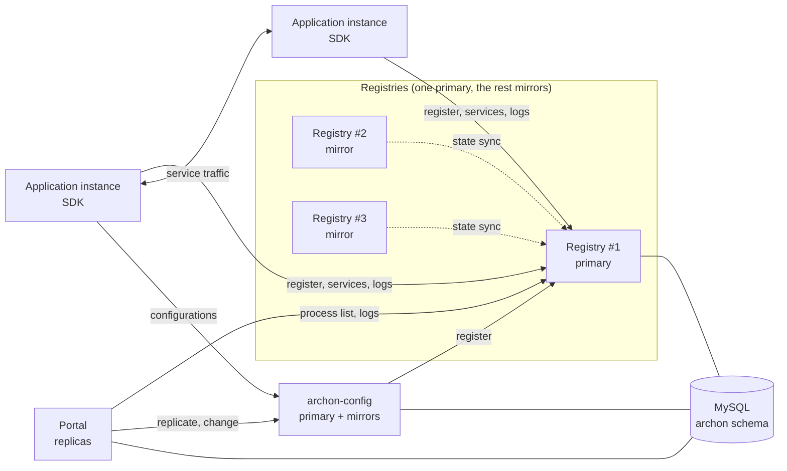
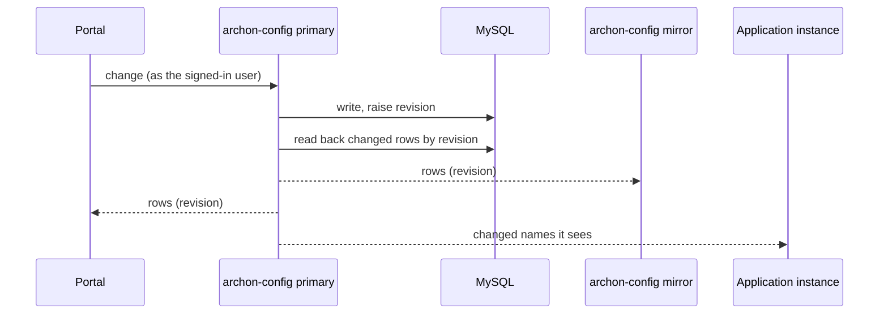
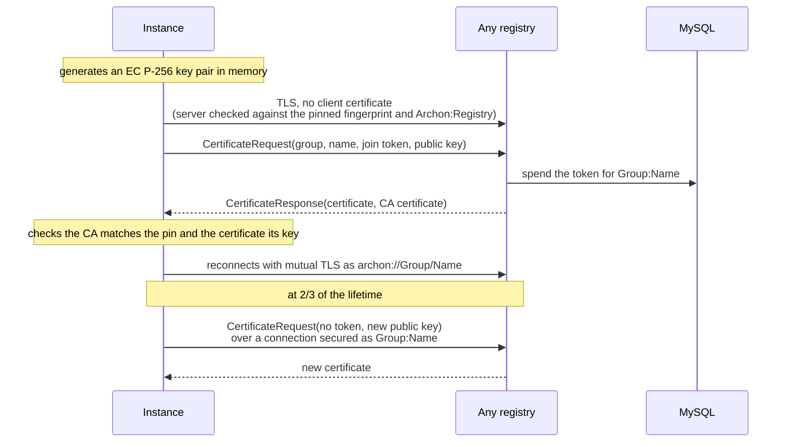
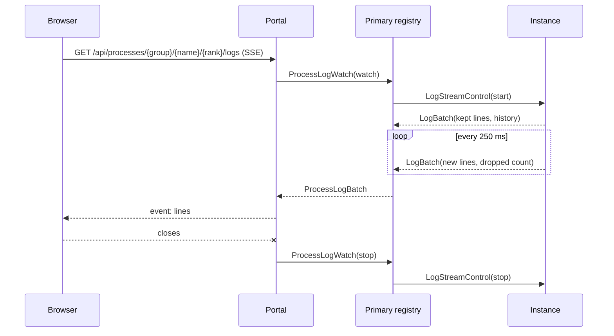

# Archon technical reference

Archon coordinates a fleet of application processes. It knows which instances of which applications are running,
gives each instance a rank so every application has exactly one leader, tells clients where each service is
served, distributes configurations, issues the certificates instances prove their identity with, and lets operators
watch all of it, logs included, from a web portal.

This document describes how it works. To write an application on Archon, read the
[SDK developer guide](sdk-developer-guide.md).

## Contents

1. [Components](#1-components)
2. [Concepts](#2-concepts)
3. [Transport: DataBridge](#3-transport-databridge)
4. [The registry](#4-the-registry)
5. [Registry leader election](#5-registry-leader-election)
6. [Application instances, ranks and leaders](#6-application-instances-ranks-and-leaders)
7. [Services](#7-services)
8. [Configurations: archon-config](#8-configurations-archon-config)
9. [Security: TLS, identities and join tokens](#9-security-tls-identities-and-join-tokens)
10. [Live logs](#10-live-logs)
11. [The portal](#11-the-portal)
12. [Data model](#12-data-model)
13. [Deployment](#13-deployment)
14. [Configuration reference](#14-configuration-reference)
15. [Operations](#15-operations)

---

## 1. Components



| Module | What it is |
|---|---|
| `archon-dictionary` | The shared vocabulary: every message the components exchange, the protocol constants, and the TLS building blocks (identities, trust, certificates, join tokens). Every other module depends on it. |
| `archon-registry` | The registry server. Several run together; one is the primary and the others mirror its state. Applications register with the primary. |
| `archon-sdk` | The Java library applications use to register, take a rank, serve and consume services, read configurations, join with TLS and stream their logs. |
| `archon-config` | Archon's configuration service: an application built on the SDK, run as a primary and mirrors, serving configurations from the database to every instance. |
| `archon-portal` | The web console: processes, applications, services, configurations, users and roles, live logs. A Java backend serving a React frontend, run as any number of replicas. |

All of them talk over [DataBridge](#3-transport-databridge), a small message transport on Netty that lives in its
own repository. Registries, archon-config and the portal share one MySQL schema, `archon`.

Archon's own components register like any application, under the group `Archon`: `Archon:Registry`,
`Archon:Config` and `Archon:Portal`. They appear in the portal next to user applications.

## 2. Concepts

**Application definition.** A `Group:Application` pair, such as `Shop:Cart`. Only defined applications may
register ([§6.1](#61-registration)). Group and name are identifiers: a letter or digit, then letters, digits, dots,
dashes or underscores, up to 128 characters.

**Instance.** One process of an application. Each holds a **rank** within its application, unique among its running
instances.

**Rank.** `1` is the application's **leader** (for registries, the **primary**). Higher ranks are **mirrors** or
standbys. Two more values appear on the wire: `0`, a registry that has not been ranked yet, and `-1`, an instance
registering for the first time.

**Run level.** Where an instance is in its life:

| Run level | Counts as running | Meaning |
|---|---|---|
| `STARTING` | yes | Registered, has a rank, has not acknowledged it yet. |
| `RUNNING` | yes | Acknowledged its rank: ready, and may be promoted. |
| `CHANGING` | yes | Promoted to leader, has not acknowledged the new rank yet. |
| `SHUTTING_DOWN` | yes | Stopping. |
| `KILLED` | no | Disconnected, or did not reconnect after a failover. |
| `FAILED`, `TERMINATED`, `NOT_RUNNING`, `UNKNOWN` | no | Not running. |

A record that stops running keeps its rank number, so the portal can show it as a *former leader* or *former
standby*. The rank becomes free for a new instance.

**Service.** Something an application instance serves on a port, such as `ping`. Defined once, centrally
([§7](#7-services)), with an owner application, a port offset and a mode.

**Configuration.** A named, typed value at one of three levels: global, a group, or an application. The most
specific one an instance can see wins ([§8](#8-configurations-archon-config)).

**Identity.** With TLS on, every process holds a certificate naming its application definition as the URI
`archon://Group/Name`. Peers trust each other by that identity, never by address ([§9](#9-security-tls-identities-and-join-tokens)).

## 3. Transport: DataBridge

Every Archon connection is a DataBridge connection: a TCP connection, optionally TLS, carrying length-prefixed
messages.

**Framing and encoding.** Each frame is a 4-byte length followed by a Java-serialized object implementing
`dev.heysulo.databridge.core.common.Message`. Frames are limited to 16 MB by default.

**Deserialization filter.** Every frame is read through an `ObjectInputFilter`: structural limits plus an allow-list
of packages. The defaults allow `dev.heysulo.**`, `java.lang.*` and a few `java.util` types, and explicitly refuse
`java.rmi.**`, `java.lang.reflect.**`, `java.lang.invoke.**` and `java.util.PriorityQueue`. Anything not allowed is
rejected before it is constructed. An application sending its own message classes adds their package with
`ProtocolSettings.addTrustedPackage`.

**Handshake.** A new connection exchanges a handshake (version and client id) before any message, under a stricter
filter and a 4 KB frame limit, with a 10 s timeout. Only then do the `onConnect` callbacks run.

**Heartbeats.** Each side sends heartbeats at an interval (30 s by default) and drops a peer silent for two
intervals. Archon uses 3 s between registries and between applications and registries, so a dead peer is noticed
within about 6 s. Heartbeats also measure latency.

**TLS.** `SecureServer` takes either a fixed `SslContext` or a supplier, so certificates can be renewed while it runs:
each new connection uses the context current when it is accepted. It can also accept plain and TLS clients on one
port, telling them apart by the first five bytes (a TLS record header), which Archon uses while a cluster moves to
TLS. Connections expose `isSecure()` and the certificates the peer presented. `Client` takes an optional
`SslContext`; Archon turns off hostname verification and checks identities instead.

## 4. The registry

The registry is the coordination point. It listens on **port 8080**.

### 4.1 The registry cluster

Run three (or any odd number of) registries. Every registry and every application is given the same list of
registry addresses, separated by `|`, in `ARCHON_REGISTRY_LOCATIONS`. Each registry also needs its own address from
that list in `MY_EXTERNAL_IP`, which it uses to identify itself in elections.

One registry is the **primary**. It alone accepts registrations, answers service lookups and pushes the process
list. The others are **mirrors**: each registers with the primary as `Archon:Registry`, receives a full copy of its
state, then every change as it happens. If the primary goes, the mirrors elect a new one from among themselves
([§5](#5-registry-leader-election)), and it already holds the state.

Registry state is held in memory only: application records, ranks, tokens, running services. Nothing about
instances is stored in the database. If every registry is lost at once, instances re-registering with their old
ranks are refused and restart; a rolling restart never loses the state ([§15.1](#151-rolling-restarts)).

### 4.2 Startup sequence

1. Starts log capture, so the first watcher sees how the registry started ([§10](#10-live-logs)).
2. With a database configured: loads the service catalog (retrying for 30 s, since a registry without its services
   would refuse every one), prepares and loads application definitions, creates the `join_tokens` table, reads the
   log settings, and starts reloading services, definitions and log settings every 10 s.
3. With TLS on: loads or creates the Archon CA and issues its own certificate ([§9](#9-security-tls-identities-and-join-tokens)).
4. Starts the server on port 8080.
5. Runs an election: connects to every other registry and either leads or follows.
6. As primary, becomes ready at once. As a mirror, registers with the primary, acknowledges its rank, receives the
   state snapshot, and becomes ready when the snapshot is complete.

### 4.3 State synchronisation

When a mirror acknowledges its rank, the primary sends it one `ApplicationSyncMessage` per known application
record (group, name, rank, run level, token, details), then a `StateSnapshotComplete` marker on the same
connection, so it arrives after every record. From then on, every change to a record is synced to every connected,
running mirror as it happens.

A record's token is generated before its first sync, so a mirror promoted while an instance is still starting
accepts that instance when it re-registers.

### 4.4 Readiness

A registry is *ready* when it is the primary, or a mirror holding the primary's complete state. It writes a file
while ready (`ARCHON_READY_FILE`, default `/tmp/archon-registry-ready`) and deletes it while not. In Kubernetes a
readiness probe reads the file, so a rolling restart waits for each restarted registry to hold the state before
restarting the next. A mirror following a primary too old to send the completion marker is ready anyway after 20 s.

### 4.5 Failover

```mermaid
sequenceDiagram
    participant P as Primary
    participant M as Mirror
    participant A as Application
    P--xM: connection lost (heartbeats stop, ~6 s)
    P--xA: connection lost
    M->>M: not ready; election
    M->>M: wins: acts as primary, term+1, ready
    A->>M: lookup finds the new primary
    A->>M: re-register with rank and token
    M-->>A: rank kept
    Note over M: 20 s reconnect grace
    M->>M: retire records that did not reconnect,<br/>elect leaders where needed
```

1. Mirrors notice the primary is gone when its connection drops or its heartbeats stop, within about 6 s.
2. They mark themselves not ready and elect a new primary ([§5](#5-registry-leader-election)).
3. The winner starts acting as primary. It already holds every record, but none of the instances' connections.
4. Instances notice the loss the same way, look for the primary among the registry addresses, reconnect and
   re-register with their rank and token, and announce their services again.
5. For 20 s (**reconnect grace**) the new primary waits for them. During the grace it does not promote anyone: a
   leader whose record has no connection may simply not have reconnected yet.
6. When the grace ends, records still without a connection are marked `KILLED`; any application left without a
   live leader gets one ([§6.4](#64-leaders-and-promotion)). Registry records of mirrors it cannot see are retired
   at once; those registries rejoin through an election.

### 4.6 Registry messages

| Message | From → to | Purpose |
|---|---|---|
| `PrimaryRegistryLookupMessage` / `…ResponseMessage` | anyone → any registry | "Are you the primary, and in which term?" Applications ask every listed registry. |
| `ApplicationRegistrationMessage` / `…ResponseMessage` | instance → primary | Register or re-register; answered with the rank and a token. |
| `ApplicationRankUpdate` | both ways | The primary announces a rank change; an instance acknowledges a rank. |
| `ApplicationTerminationMessage` | primary → instance | Stop, with a reason. |
| `ServiceLookupMessage` / `…ResponseMessage` | anyone → primary | A service's definition and running endpoints. |
| `ServiceStartedMessage` / `ServiceStartResponseMessage` / `ServiceStoppedMessage` | instance → primary | Announce, confirm and withdraw a running service. |
| `ProcessListRequest` / `ProcessListResponse` | anyone → primary | The current process list. |
| `ProcessWatchRequest` | portal → primary | Push the process list on every change (debounced by 100 ms). |
| `VerifyInstanceRequest` / `…Response` | component → primary | "Is this group/name/rank running with this token?" archon-config uses it to trust callers. |
| `CertificateRequest` / `CertificateResponse` | instance → any registry | Join or renew a certificate ([§9.4](#94-joining-and-renewal)). |
| `ProcessLogWatch` / `ProcessLogBatch` | portal ↔ primary | Watch an instance's live logs ([§10](#10-live-logs)). |
| `LogStreamControl` / `LogBatch` | primary ↔ instance | Start or stop an instance's log stream; its lines. |
| `InstanceMetricsReport` | instance or mirror → primary | CPU and memory use, every 5 s ([§6.5](#65-resource-use)). |
| `VoteRequest`, `VoteResponse`, `LeaderElectionMessage`, `LeaderStatusMessage`, `PrimaryStanding`, `RegistryRegistration…` | registry ↔ registry | Election, status and rival resolution. |
| `ApplicationSyncMessage`, `StateSnapshotComplete` | primary → mirror | State synchronisation. |

## 5. Registry leader election

Elections pick one primary out of the configured registries, require a majority, and number each primary's tenure
with a **term**.

### 5.1 Who should lead

A registry starts with rank `0`, connects to every other registry it can reach, and learns each one's rank, term,
address and start time. It then decides, by these rules in order:

1. If any visible registry is the primary, **follow** it.
2. An established mirror (rank 2 or more) **leads** unless a visible mirror has a lower rank, in which case it
   **waits**. The lowest-ranked mirror inherits.
3. A fresh registry (rank 0) **waits** if any established mirror is visible.
4. Otherwise, among fresh registries, the one started earliest **leads** (ties broken by address); the rest wait.
5. Whatever the rules say, it only leads if it and the peers it can see make up a **quorum**: more than half of
   all configured registries (`n/2 + 1`). A minority partition never elects a primary.

### 5.2 Winning a term

A registry that decides to lead asks for votes for term `max(known term, own last vote) + 1`:

* It votes for itself, then sends a `VoteRequest` to every connected peer and waits up to 1 s.
* A peer grants its vote only if it is not connected to a primary, the term is newer than any it has seen won,
  it has not backed someone else for this term, and the same rules, applied to what *it* can see, say the candidate
  should lead.
* A vote is a **lease**: for 3 s a voter backs nobody else, giving the winner time to register it.
* With a quorum of votes the candidate becomes primary for that term. Without one it backs off for a random 0–1 s,
  so rival candidates do not keep splitting the vote, and tries again.

The primary's term is reported to applications in lookups and registrations. Applications prefer the primary with
the newest term when two claim the role.

### 5.3 Rival primaries

A partition can leave two primaries. Every 2 s a primary looks for registries it cannot see. When it finds another
primary, the two exchange `PrimaryStanding`s and keep the stronger, compared in this order:

1. More **supporters** (connected, running mirrors, plus itself).
2. Newer **term**.
3. Earlier **start time**.
4. Lower **address**.

The loser logs why, waits 1 s so its standing reaches the winner, and exits, so its orchestrator restarts it as a
fresh registry that then follows the winner. The winner moves its term past the loser's, so instances that followed
the loser accept it. Instances of the loser reconnect to the winner.

## 6. Application instances, ranks and leaders

### 6.1 Registration

An instance registers by sending `ApplicationRegistrationMessage` to the primary with its group, name, rank (`-1`
the first time), its token if it has one, where it runs (host, address, node), and whether it had acknowledged its
rank. The primary checks, in order:

1. **Definition.** The application must be defined, or be one of Archon's own. Otherwise: *Application is not
   defined*.
2. **Certificate**, when TLS is on ([§9.6](#96-enforcement)). A certificate naming another application: *The
   certificate is for another application*. None while TLS is required: *A certificate is required*.
3. **New instance** (rank `-1`): it takes the lowest rank not held by a running instance, reusing that rank's old
   record. A fresh token is generated. The instance becomes `STARTING`.
4. **Re-registration** (a rank it was given before):
   * No record for that rank: *Provided rank is not available re-registration*.
   * The record is running with a different token, so another instance holds it: *Rank is held by another running
     instance*.
   * Otherwise the instance reclaims it: `RUNNING` if it had acknowledged, `STARTING` if not.

A refused instance receives `ApplicationTerminationMessage` with the reason. The SDK then stops talking to the
registry and, by default, exits the process so its orchestrator starts a fresh one.

The registration response carries the rank, the primary's term and the instance's **authentication token**. The
token proves the instance's identity to the registry (on re-registration) and to other components (archon-config
asks the registry to verify it).

### 6.2 Application definitions

Definitions live in the `application_definitions` table. The registry creates it if it is missing and, the first
time, defines every application that owns a service, so running applications keep registering. It reloads the
definitions every 10 s. Archon's own components are always defined. Without a database every application may
register, as in development.

Removing a definition refuses the application's instances the next time they register or re-register; instances
already registered keep running until then. The portal refuses to remove a definition with running instances or
services.

### 6.3 Acknowledging a rank

A rank is assigned before the instance is ready for it. The instance stays `STARTING` (or `CHANGING`, after a
promotion) until it acknowledges the rank by sending `ApplicationRankUpdate` back with the same rank. Only then is
it `RUNNING`. An application acknowledges once its role's work is done: services started, connections made,
caches warmed.

An acknowledgement of a rank that is no longer the instance's current one is ignored: the instance was promoted
while finishing its last role, and acknowledges the new rank when ready for it.

### 6.4 Leaders and promotion

Every application has at most one rank-1 instance, its leader.

* **The leader disconnects or is retired**: the primary promotes the first `RUNNING` instance it finds. It takes
  rank 1, becomes `CHANGING` and is told its new rank. Instances still `STARTING` are never promoted.
* **No live leader, and an instance becomes ready**: if the leader went while every other instance was still
  starting, nobody was promoted then; the first instance to become ready is promoted now. This is skipped during a
  new primary's reconnect grace.
* **A promotion that cannot be delivered** (the candidate's connection fails) marks it `KILLED` and tries the next.

The promoted instance's old rank becomes free. Other instances keep their ranks.

### 6.5 Resource use

Every SDK instance measures itself every 5 s and reports to the primary with `InstanceMetricsReport`: its share of
the CPUs available to it, those CPUs (its container's limit), resident memory (on Linux, from `/proc/self/status`),
the memory available to it (its container's limit), heap used and maximum, memory outside the heap, live threads and
uptime. The JVM's management beans are container aware, so the limits are the container's. Registries measure
themselves the same way: the primary keeps its own figures, and mirrors report to it like instances.

The primary keeps the latest report with the instance's record, drops it when the instance stops, and includes it in
the process list. Reports from many instances share one push to watchers, at most every 2 s. Reports are not synced
to mirrors: a new primary hears them again within 5 s.

Compatibility: registries say they accept reports in their lookup and registration answers, and portals ask for
metrics in their process list requests. An older registry is never sent a report and an older portal never a list
with metrics, since an unknown class makes DataBridge close the connection.

## 7. Services

### 7.1 Definitions

A service is a row in the `services` table:

| Field | Meaning |
|---|---|
| `id` | What instances start and clients look up, such as `ping`. Case sensitive. |
| `name` | For people. |
| `port_offset` | Added to the serving instance's base port (`ARCHON_BASE_PORT`) to give its port. Unique across every service, from 0 to 65534. |
| `app_group`, `app_name` | The owner: the one application definition whose instances may serve it. |
| `mode` | `PRIMARY_MIRROR`: clients use the lowest-ranked running instance, the others stand by. `LOAD_BALANCE`: clients spread over every running instance. |

Registries reload the services every 10 s, so changes from the portal reach them without a restart. Services of the
`Archon` group are managed by Archon: archon-config writes its own service, `archon-config` at offset 0, on every
start.

The portal refuses to change or delete a service any instance is serving, and refuses an owner that is not a defined
application ([§11](#11-the-portal)).

### 7.2 Serving

An instance starting a service:

1. Looks the service up, to learn its port offset and check it owns it.
2. Starts a DataBridge server on `ARCHON_BASE_PORT + port_offset`.
3. Sends `ServiceStartedMessage` with the address clients should use (`ARCHON_ADVERTISED_HOST`, or the address the
   registry sees), the port, and whether it serves TLS.

The primary accepts it only if the service is defined, the instance's application owns it (any rank may serve), and
the port is valid. Otherwise the SDK stops the server and reports why.

Running services are held in the primary's memory, keyed by instance; they are not synced to mirrors. After a
failover, every instance announces its services again to the new primary.

### 7.3 Lookup and clients

A lookup returns the definition and the running endpoints: only instances that are running and connected, lowest
rank first. For a `PRIMARY_MIRROR` service the first is marked `primary`. Each endpoint also says whether it serves
TLS.

The SDK's service client connects to the primary endpoint (or a random one, when load balanced). When the connection
drops it looks the service up again and reconnects, possibly to a newly promoted instance, telling the application
about each disconnect and connect. Clients can **warm up** a connection: the SDK sends round trips the server's SDK
answers automatically before handing the connection over.

## 8. Configurations: archon-config

archon-config is an SDK application, `Archon:Config`, run as a primary and mirrors. Its primary serves the
`archon-config` service; on port 9100 when started with `ARCHON_BASE_PORT=9100`.

### 8.1 The model

| Field | Meaning |
|---|---|
| level | `GLOBAL`, `GROUP` or `APPLICATION`. |
| group, application | Empty at the global level; the application only at the application level. |
| name | Identifier, as for definitions. |
| type | `STRING`, `INTEGER`, `DECIMAL` or `BOOLEAN`. Values are stored in canonical form. |
| value | The value. |
| read only | Applications cannot change it; the portal still can. |
| description | For people. |

An instance of `Group:Application` sees, for each name, its application's configuration if there is one, else its
group's, else the global one. Changes record who made them (a portal user, or an application as `Group/Name`).

### 8.2 Storage and revisions

Configurations are rows of the `configurations` table. Every write raises a single counter in
`configuration_revision`, in the same transaction, and stamps the row with it. Deleted configurations are kept,
marked deleted, so readers notice deletions by revision too. Anyone can then ask for *everything changed since
revision N*.

### 8.3 Primary and mirrors



* **The primary** holds every configuration in memory, indexed by who sees it (global, per group, per
  application), so serving one instance or applying one change costs the same however many configurations exist.
  It writes changes to the database, reads back what changed by revision, and passes it on.
* **Replicas** (archon-config's mirrors and every portal replica) hold every row. On connecting they say which
  revision they have and receive only what they missed, or everything the first time, then every change. Batches
  apply whole, once their last piece arrives.
* **Applications** receive only what they see: a snapshot of their effective configurations, then a
  `ConfigChanged` for each name whose effective value changed. A change to a global value hidden by the
  application's own is not sent.
* Large snapshots are split into chunks of at most 4 MB.
* The primary also re-reads the database every 30 s, so a change written by any other path is still picked up.

A mirror promoted to primary reads the database first, so it serves anything the old primary wrote but never pushed.

### 8.4 Trust

Every connection to archon-config must first send `ConfigHello` with its group, name, rank and registration token.
archon-config asks the primary registry to verify it (`VerifyInstanceRequest`) and refuses everything until it is
confirmed. An application may then read what it sees and set values of configurations it sees that are not read only.
Only `Archon:Portal` may list and change every configuration.

### 8.5 Built-in configurations

archon-config creates these global configurations on start if they are missing, read only to applications. Existing
values are never changed; a deleted one returns with its default on the next start.

| Name | Type | Default | Meaning |
|---|---|---|---|
| `archon.logs.memoryLines` | INTEGER | 1000 | Log lines each instance keeps in memory for live logs; 0 keeps none, at most 100 000. |
| `archon.logs.memoryLevel` | STRING | WARN | The lowest level kept in memory: TRACE, DEBUG, INFO, WARN or ERROR. |

## 9. Security: TLS, identities and join tokens

### 9.1 Modes

`ARCHON_TLS` sets each component's mode:

| Mode | Registry port | Registry ↔ registry | Clients | Certificates on connections |
|---|---|---|---|---|
| `off` (default) | plain | plain | plain | none |
| `optional` | TLS and plain on one port | plain | TLS once joined | checked if presented |
| `required` | TLS only | TLS, both sides `Archon:Registry` | TLS | required for everything except finding the primary and joining |

A cluster moves from `off` to `optional` to `required` one component at a time. In `optional`, servers accept both,
so old and new components keep talking while each is switched over.

### 9.2 Identities

Every certificate names exactly one application definition, as a URI subject alternative name
`archon://Group/Name`. Connections are trusted by that identity, not by address or hostname, so an instance is
recognised wherever it runs, inside Kubernetes or out:

* A client of the registry accepts only a certificate naming `Archon:Registry`.
* A client of a service accepts only a certificate naming the service's owner.
* The registry admits a registration only if the certificate names the application registering.

A certificate naming two identities, or a CA certificate presented as a peer's own, is refused.

### 9.3 The Archon CA

Archon runs its own certificate authority, held by the registries:

* **Created** by the first registry started with TLS: an EC P-256 key and a self-signed certificate valid for 10
  years, stored in the `certificate_authority` table. Every other registry loads the same CA, so any of them can
  issue certificates and a failover does not lose it.
* **Protected** by a master key: the CA's private key is sealed with AES-256-GCM under a key derived from
  `ARCHON_CA_MASTER_KEY` (at least 16 characters) with PBKDF2-HMAC-SHA256 and 310 000 iterations, with a fresh salt
  and nonce per sealing. The database alone does not give the key away. Losing the master key means a new CA, and
  every instance joining again.
* **Leaf certificates** are EC P-256, valid for both server and client authentication, back-dated 5 minutes for clock
  skew, and live for `ARCHON_CERT_LIFETIME_HOURS` (24 hours by default, never past the CA's own expiry).
* **Fingerprint.** The SHA-256 fingerprint of the CA certificate, as 64 hex digits, is what instances pin. Registries
  log it at start and the portal shows it. It is public, but it is what stops anyone else posing as a registry, so
  instances should get it from a source they trust.

### 9.4 Joining and renewal



* An instance **joins** with a join token for its application definition. Its private key never leaves its memory and
  nothing is written to disk.
* Any registry answers, primary or mirror, since every one holds the CA. The instance tries each registry address in
  turn and keeps trying every 3 s until one issues.
* A registry issues only for a defined application, never for `Archon:Registry` (registries issue their own), and
  only with a valid token or, for a **renewal**, over a connection already secured with a certificate for the same
  identity.
* The instance **renews** two thirds of the way through its certificate's life, with a new key pair, retrying every
  minute on failure. New connections use the new certificate; existing ones keep theirs.
* Each registry issues and renews its own `Archon:Registry` certificate the same way, from the CA directly.
* `Archon:Portal` and `Archon:Config` can already reach the database, so they read the CA certificate from it and mint
  their own single-use, 10-minute join token there instead of being given a fingerprint and a token.

### 9.5 Join tokens

* A token is `ajt_` followed by 32 random bytes, base64url. Only its SHA-256 hash is stored, in `join_tokens`.
* A token belongs to one application definition, may expire, and is **single-use** (spent by the first request) or
  **reusable** (for instances that scale out), until it expires or is revoked.
* Spending is a conditional update, so two requests cannot both spend a single-use token.
* Revoking a token stops new instances joining with it. Instances that joined keep their certificates, and renew
  them without the token.
* Every refusal of a bad token gives one answer, so it does not reveal which tokens exist.

### 9.6 Enforcement

With TLS **required**, the registry:

* refuses plain connections at the first bytes;
* admits election, status and state messages only from a certificate naming `Archon:Registry`;
* drops any other message from a caller without a certificate, except finding the primary and joining;
* refuses registrations whose certificate names another application, or that present none;
* lets only `Archon:Portal` watch logs.

SDK service servers in `required` mode refuse plain connections and require a client certificate from the CA; in
`optional` they accept both. SDK clients connect to a TLS endpoint with TLS, checking the server is the service's
owner, and refuse plain endpoints when TLS is required.

### 9.7 What TLS does not cover

* Messages are still Java-serialized; the deserialization filter ([§3](#3-transport-databridge)) is what keeps
  unknown classes out. TLS keeps untrusted senders from reaching it in `required` mode.
* The portal serves HTTP unless given a certificate ([§11.5](#115-https)). Browsers must trust that certificate, so
  it usually comes from your own CA or a public one, not the Archon CA.
* Data at rest in MySQL is not encrypted by Archon, apart from the sealed CA key.

## 10. Live logs

Operators can watch any instance's log lines live from the portal, registries included.

### 10.1 Capture

Each process captures its own log lines in memory, through the SDK:

* When the application logs through **Logback**, **Log4j 2** or **java.util.logging** (as slf4j's backend), an
  appender or handler is added to the root logger, giving each line its level, logger, thread and time.
* Otherwise, as with **slf4j-simple**, standard output and standard error are captured as they are written, still
  reaching the console. slf4j-simple's format (`[thread] LEVEL logger - message`) is parsed. A stack trace's lines,
  including its first `java.x.SomeException: …` line, take the level of the line that logged it; other console lines
  count as `STDOUT` or `STDERR`.
* Capturing never blocks: it only stores the line. Messages longer than 16 KB are cut.
* `ARCHON_LOG_CAPTURE=off` turns capture off.

Registries are not SDK applications, but they use the SDK's capture as a library.

### 10.2 What is kept, and what is streamed

* Each process keeps its latest lines at or above a level, by `archon.logs.memoryLines` and
  `archon.logs.memoryLevel` ([§8.5](#85-built-in-configurations)). Instances follow changes at once; archon-config
  and the portal read them every 30 s; registries read them from the database every 10 s, as `Archon:Registry`.
  `STDERR` counts as ERROR and `STDOUT` as INFO for this.
* While someone watches, **every** line is streamed, whatever its level.

### 10.3 Streaming



* An instance sends nothing unless watched. The registry asks it to start with the first watcher and to stop after
  the last, however many watch.
* Batches go every 250 ms, at most 500 lines each; a queue of 10 000 lines absorbs bursts, and lines beyond it are
  dropped and counted, never blocking the application.
* The primary registry relays lines to its watchers. It serves its own lines directly, and a mirror registry sends
  its lines to the primary over the connection it already holds.
* After a failover or reconnect, the portal asks the new primary again, and the primary asks instances again when they
  re-register.
* Nothing is stored anywhere. Live logs are for watching a few instances now; use a log store for history and search.

## 11. The portal

The portal is `Archon:Portal`, a Java backend (the JDK HTTP server) serving a React single-page application. Run
any number of replicas: each registers with the registry, watches the process list, replicates every configuration
and serves the full API. Sessions live in the database, so a browser can be served by any replica.

### 11.1 Pages

| Page | What it does |
|---|---|
| Processes | Every instance in one table, updated live, grouped under its application (groups fold away) and sortable inside each group, with its CPU and memory use. Tiles above count the running instances that want a look: disconnected from the registry, not ready (running but not `RUNNING`), serving a service without TLS, or at 90% or more of their CPU or memory; pressing a tile shows only those. Services carry a closed lock in green when served over TLS, an open lock in red when not. Click an instance for one drawer with three tabs: its overview, every configuration it sees (with where each comes from, to edit, override for the application or remove an override), and its live logs, which stream only while that tab is open. |
| Applications | Define and remove applications; assign services; manage join tokens and see the CA fingerprint. An application's running count links to its instances in Processes (`/processes?application=Group:Name`). |
| Services | Define services, their owner, port offset and mode. Running services are locked. A service's owner links to that application's instances in Processes. |
| Configurations | Every configuration at every level, searchable and paged. |
| Users, Roles | Users (searchable by username, name or role), custom roles and their permissions. |

### 11.2 Users, roles and permissions

Users hold roles, and roles grant permissions. The built-in `admin` role grants `*`, every permission including any
added later.

| Permission | Allows |
|---|---|
| `processes:view` | See running processes. |
| `logs:view` | Watch processes' logs live. Logs can hold secrets, so this is separate. |
| `applications:view`, `applications:manage` | See, and define or remove, application definitions; manage join tokens. |
| `services:view`, `services:manage` | See, and change, service definitions; assign services. |
| `configs:view`, `configs:manage` | See, and change, configurations. |
| `users:view`, `users:manage` | See, and change, users and their roles. |
| `roles:view`, `roles:manage` | See, and change, roles. |

A feature's `manage` includes its `view`. Nobody can grant a permission or assign a role they do not fully hold, and
the portal refuses any change that would leave no enabled user able to manage users and roles.

**First admin.** While no users exist, each replica logs a one-time setup token, valid for 24 hours, for creating the
first admin at `/setup`.

**Sessions.** A session cookie (`HttpOnly`, `SameSite=Strict`, `Secure` over HTTPS) ends after 12 hours idle or 7
days at most. Every request that changes something must come from the portal's own pages (an `Origin` check).

### 11.3 API

All under `/api`, JSON, authenticated by the session cookie.

| Endpoint | Permission |
|---|---|
| `GET /auth/state`, `POST /auth/setup`, `POST /auth/login`, `POST /auth/logout`, `POST /auth/password` | – |
| `GET /users`, `POST /users`, `PUT/DELETE /users/{id}`, `POST /users/{id}/password` | `users:view` / `users:manage` |
| `GET /roles`, `POST /roles`, `PUT/DELETE /roles/{id}` | `roles:view` / `roles:manage` |
| `GET /processes` | `processes:view` |
| `GET /events` (server-sent events: `snapshot`, `offline`, `signedout`) | `processes:view` |
| `GET /processes/{group}/{name}/{rank}/logs` (server-sent events: `lines`, `signedout`) | `logs:view` |
| `GET /applications`, `POST /applications`, `PUT/DELETE /applications/{group}/{name}` | `applications:view` / `applications:manage` |
| `GET/POST /applications/{group}/{name}/tokens`, `DELETE …/tokens/{id}` | `applications:manage` |
| `GET /tls` | `applications:view` |
| `GET /services`, `POST /services`, `PUT/DELETE /services/{id}`, `PUT /services/{id}/owner` | `services:view` / `services:manage` |
| `GET /configs?q=&level=&offset=&limit=`, `POST /configs`, `PUT/DELETE /configs/{id}` | `configs:view` / `configs:manage` |
| `GET /configs/effective?group=&application=` | `configs:view` |

The portal changes configurations through archon-config as its own verified identity, recording the signed-in user
as the author. Its process list and live logs come from the primary registry over one connection per replica, which
follows the primary across failovers.

### 11.4 Guards on changes

* A service an instance is serving cannot be changed, reassigned or deleted. When no registry answers, whether it is
  running is unknown, so the change is refused too.
* A service's owner must be a defined application, and its port offset unused.
* An application definition with running instances or services cannot be removed.
* Archon's own applications and services cannot be changed from the portal.

### 11.5 HTTPS

With `PORTAL_TLS_CERT` (a PEM certificate chain, the portal's own first) and `PORTAL_TLS_KEY` (an unencrypted PKCS#8
PEM key, EC, RSA or Ed25519) set, the portal serves HTTPS. It checks the files every minute and uses a renewed
certificate without a restart. Behind a TLS-terminating proxy, `X-Forwarded-Proto: https` marks the session cookie
`Secure`.

## 12. Data model

Everything lives in the MySQL schema `archon`. Each component creates what it needs if it is missing.

| Table | Created by | Holds |
|---|---|---|
| `services` | schema | Service definitions ([§7.1](#71-definitions)). |
| `application_definitions` | registry | Defined applications: group, name, description. |
| `join_tokens` | registry and portal | Join tokens: application, SHA-256 hash, description, reusable, expiry, last use and count, creator. |
| `certificate_authority` | registry | The CA certificate and its sealed private key, one row. |
| `configurations` | archon-config | Configurations, with revision, author and a deleted flag. |
| `configuration_revision` | archon-config | The latest revision, one row. |
| `portal_users`, `portal_roles`, `portal_role_permissions`, `portal_user_roles` | portal | Users (passwords hashed), roles and what they grant. |
| `portal_sessions`, `portal_setup_tokens` | portal | Sessions and first-admin tokens, by hash. |

Instance state (records, ranks, tokens, running services) is never stored; it lives in the registries' memory.

## 13. Deployment

### 13.1 Building

```bash
mvn clean install
```

builds every module with checkstyle, SpotBugs and the tests, and the portal's frontend through Node. Modules compile
with `--release 17`, so they run on Java 17 and cannot use a newer API by accident. Each runnable module is shaded
into one jar and has a `Dockerfile`. DataBridge is built and installed from its own repository first.

### 13.2 Kubernetes

The manifests in each module's `k8s` directory deploy to a cluster with a load balancer (MetalLB in the reference
setup):

* **Registries**: a StatefulSet `archon-registry` of three pods, each with its own LoadBalancer Service and fixed
  address (`archon-registry-N-svc`), so applications and registries outside the pod network reach a specific
  registry. Services set `publishNotReadyAddresses`, since an unready registry may be mid-election; readiness only
  paces rollouts. The pod's ordinal picks its own address from `ARCHON_REGISTRY_LOCATIONS` for `MY_EXTERNAL_IP`. A
  readiness probe reads the ready file every 2 s.
* **archon-config**: a Deployment of two replicas, advertising its pod IP.
* **Portal**: a Deployment of two replicas behind a LoadBalancer Service.
* **Secrets**, created by hand and never committed: `archon-db` (database user and password) and `archon-ca`
  (`master-key`).
* **ConfigMap** `archon-tls`: `mode` and `ca-fingerprint`, read by every component and application.

Pods advertise their pod IP (`ARCHON_ADVERTISED_HOST`), since the registry would otherwise see the node's address
through the load balancer's NAT.

### 13.3 Outside Kubernetes

Nothing depends on Kubernetes. Any process that can reach the registry addresses can register: set the environment
variables in [§14](#14-configuration-reference), and with TLS on give it the CA fingerprint and a join token.

## 14. Configuration reference

### Registry

| Variable | Default | Meaning |
|---|---|---|
| `ARCHON_REGISTRY_LOCATIONS` | – | Every registry's address, separated by `\|`. Required. |
| `MY_EXTERNAL_IP` | – | This registry's own address from that list. Required. |
| `ARCHON_DB_URL`, `ARCHON_DB_USER`, `ARCHON_DB_PASSWORD` | – | The archon schema, such as `jdbc:mysql://host:3306/archon`. Without it, no services are defined and every application may register. |
| `ARCHON_TLS` | `off` | `off`, `optional` or `required`. |
| `ARCHON_CA_MASTER_KEY` | – | Seals the CA's key. Required with TLS on, at least 16 characters. |
| `ARCHON_CERT_LIFETIME_HOURS` | 24 | Lifetime of issued certificates. |
| `ARCHON_READY_FILE` | `/tmp/archon-registry-ready` | Exists while the registry is ready. |
| `ARCHON_LOG_LEVEL` | info | slf4j-simple's level. |
| `ARCHON_LOG_CAPTURE` | on | `off` stops capturing logs for the portal. |

### Applications (SDK), archon-config and the portal

| Variable | Default | Meaning |
|---|---|---|
| `ARCHON_REGISTRY_LOCATIONS` | – | Every registry's address, separated by `\|`. Required. |
| `ARCHON_BASE_PORT` | – | Services listen on this plus their port offset. Required to serve. |
| `ARCHON_ADVERTISED_HOST` | this machine's address | The address clients should use for this instance's services. Set it behind NAT, as in Kubernetes. |
| `ARCHON_NODE_NAME` | – | Shown in the portal, such as the Kubernetes node. |
| `ARCHON_TLS` | `off` | `off`, `optional` or `required`. |
| `ARCHON_CA_FINGERPRINT` | – | The Archon CA's SHA-256 fingerprint, with or without colons. Required with TLS on, except for archon-config and the portal. |
| `ARCHON_JOIN_TOKEN` | – | A join token for this application. Required with TLS on, except for archon-config and the portal. |
| `ARCHON_LOG_CAPTURE` | on | `off` stops capturing logs for the portal. |
| `ARCHON_DB_URL`, `ARCHON_DB_USER`, `ARCHON_DB_PASSWORD` | – | archon-config and the portal only. |
| `PORTAL_PORT` | 8080 | Portal only. |
| `PORTAL_TLS_CERT`, `PORTAL_TLS_KEY` | – | Portal only: serve HTTPS. |

## 15. Operations

### 15.1 Rolling restarts

* **Registries.** Restart one at a time, waiting for each to be ready (the StatefulSet's readiness probe does this).
  Applications ride through: they reconnect to whichever registry is primary and re-register with their ranks. A
  registry restarted while it is primary causes a failover of about 6–10 s, during which lookups and registrations
  wait.
* **Applications.** Restart freely. A leader's instance going makes the primary promote a ready instance at once.
* **Never** restart every registry at once: the state lives only in their memory.

### 15.2 Typical timings

| Event | Time |
|---|---|
| A dead peer noticed (registry or application) | ≤ 6 s (3 s heartbeats, two missed) |
| A registry election | about 1–3 s once peers are reachable |
| Instances reconnecting after a failover | within the 20 s reconnect grace |
| Records of instances that never return marked `KILLED` | 20 s after the new primary takes over |
| A service or definition change reaching registries | ≤ 10 s |
| A configuration change reaching instances | immediately; the 30 s refresh catches anything missed |
| CPU and memory in the portal | every 5 s, shown within about 2 s of a report |
| An instance stopping its log stream after the viewer closes | up to about 45 s (the portal notices on its next write) |

### 15.3 Why an instance was stopped

The reason is logged by the instance (and the registry):

| Reason | Meaning |
|---|---|
| Application is not defined | Define `Group:Application` in the portal. |
| Rank is held by another running instance | Another instance owns this rank. A fresh process takes a new rank. |
| Provided rank is not available re-registration | The registry has no record of this rank, as after every registry restarted. |
| A certificate is required. Join with a join token | TLS is required and the instance connected without a certificate. |
| The certificate is for another application | The certificate names a different application than the one registering. |

### 15.4 Moving a cluster to TLS

1. Create the master key Secret and set every component's `ARCHON_TLS` to `optional`.
2. Restart the registries. The first creates the CA and logs its fingerprint; put it in the `archon-tls` ConfigMap.
3. Restart archon-config and the portal. They join through the database.
4. Create a join token per application on the portal's Applications page, give each its fingerprint and token, and
   restart it.
5. When every process has joined, set `required` and restart everything, applications first and registries last.

A process that fails to join logs why: a refused token, an undefined application, or a registry whose certificate
does not match the pinned fingerprint.

### 15.5 Limits

* Registry state is in memory: losing every registry at once loses it.
* Live logs are not stored, and stop streaming a little after the last viewer leaves.
* Messages are Java-serialized; keep the trusted-package lists narrow.
